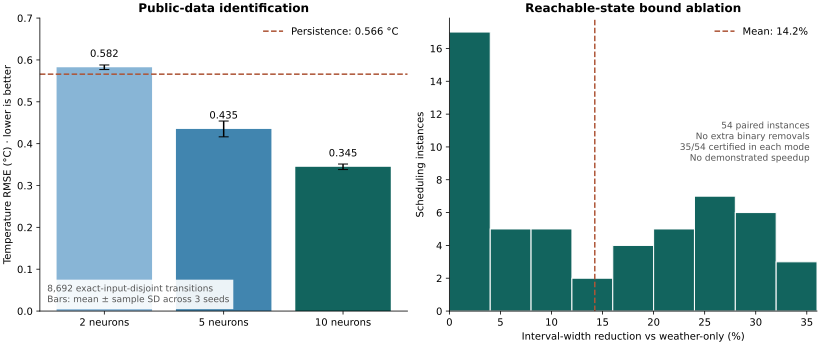

# Decision-Focused HVAC System Identification

[](https://github.com/GuidoM88/decision-focused-hvac-system-identification/actions/workflows/ci.yml)


Independent implementations of two decision-focused HVAC learning methods, a five-zone EnergyPlus control pilot, and an evaluated extension for tighter neural scheduling formulations.

The project connects PyTorch learning, differentiable convex optimization and exact mixed-integer ReLU scheduling. Every reported result has a script, raw measurements and an explicit scope.

**Scope:** methodological reproduction with numerical verification. The original papers' full EnergyPlus control tables have **not** been reproduced. [Remaining numerical-replication gates](docs/REPRODUCTION_PLAN.md) are documented separately from the completed experiments.

## Documentation

| Topic | Reference |
|---|---|
| Physical control | [EnergyPlus results and evaluation protocol](reports/energyplus/README.md) |
| Recorded trajectories | [Offline comparison demo](reports/energyplus/demo.html), opened locally after cloning |
| Implementation | [Architecture and numerical verification](docs/ARCHITECTURE.md) |
| Reproduction | [Experiment commands](#reproduce-the-experiments), manifests and raw CSVs |
| Mathematical methods | [Paper 1 mapping](docs/METHOD_MAPPING.md), [Paper 2 mapping](docs/PAPER2_METHOD_MAPPING.md), [extension and proof](docs/ORIGINAL_EXTENSION.md) |


## From prediction to physical control

Eight controllers run on the authors' pinned Small Office building in **EnergyPlus 22.1**: two thermostats, ARX/Ridge, passive RC, two neural ITO models, and stochastic/antithetic smoothing. Each evaluates a 24-hour schedule on the same four seasonal days with matched weather and two days of identical preconditioning.

The adapter checks thermostat actuation and temperatures against native SQL outputs, reconciles hourly and quarter-hour energy, and reports **electricity, backup gas and comfort separately**. Failed solves, solver gaps and engine warnings remain visible. The offline demo lets a reader inspect these tradeoffs without installing a solver or EnergyPlus.

In the recorded pilot, NN5-SS lowers mean electrical Expost+ by **5.3% versus NN5-ITO**, while passive RC achieves the lowest mean HVAC bill. The learning objective and operating cost favor different controllers. The report defines both thermostat trajectories, including the scheduled reference's overnight cooling behavior.

This is a **four-day, one-seed pilot**, with four learning epochs and a ten-second neural solve budget. It demonstrates the complete learning–optimization–simulation workflow; it does not establish annual savings, convergence or a universal DFL advantage. [Protocol, raw results and interpretation →](reports/energyplus/README.md)

## What is implemented

| Method | Learned dynamics | Learning signal | Controller |
|---|---|---|---|
| RC-ITO | Multi-zone resistance–capacitance model | Historical temperature MSE | Convex HVAC scheduling |
| RC-DFL · Paper 1 | Same RC model | Building/floor/zone power loss | CvxpyLayers differentiation |
| NN-ITO | Normalized ReLU network | Historical temperature MSE + L1 | Exact neural mixed-integer scheduling |
| NN-SS · Paper 2 | ReLU weights and biases | Gaussian score estimate of Expost+ | SCIP mixed-integer solve per sample |
| NN-QP / NN-FB · Paper 2 baselines | Same network | Supervised power loss | Continuous relaxation / fixed-activation derivative |
| NN-AS · additional comparator | Same network | Antithetic Gaussian estimate | Same total loss-evaluation budget as NN-SS |

The physical-system response is observed and detached from backpropagation. An exact ReLU encoding describes the **learned model**; it does not make that model an exact building simulator. SCIP handles the quadratic comfort objective through an equivalent convex epigraph, so no proprietary solver is needed.

## The project extension

Paper 2 tightens neural bounds by fixing known weather inputs. This project additionally propagates **reachable temperature intervals through time**, removes stable ReLU binaries, and tests whether the tighter formulation preserves the optimum.

The contribution includes a signed-weight derivation, an induction argument for preservation of feasible schedules, and a paired three-way ablation on independently trained public-data models. Interval reachability and antithetic sampling have prior literature; neither is claimed as a newly invented algorithm here.

**Observed result:** across 54 scheduling instances, recursive bounds reduce total preactivation interval width by **14.2% on average per instance** relative to weather-only bounds. They do not remove additional binaries in this experiment. Both methods certify 35/54 cases within five seconds, and 34 cases are certified by both; their objective differences are below 0.000005. There is **no demonstrated runtime advantage**. Timeouts and their incumbents remain in the report.

## Measured identification result

Train on one published typical meteorological year, validate on held-out weeks, and evaluate on the second file. Normalization uses training rows only; adjacent transitions are embargoed across the train/validation boundary.

An overlap audit finds 67 exact input matches between the weather files. On the remaining **8,692 transitions**, the 10-neuron network achieves **0.345 °C mean RMSE across three seeds**, versus **0.566 °C** for persistence: **39.1% lower RMSE**. The complete-file result is also retained. These are recorded, EnergyPlus-generated observations, not field measurements or an energy-savings claim.

Stronger comparators use the same split and train-only scaling: **ARX/Ridge: 0.464 °C; passive RC: 0.489 °C**. Regularization is chosen on validation data. A separate three-seed RC diagnosis shows that parameter perturbation damages the warm start, and short DFL training does not recover intact ITO performance. Negative results are included alongside improvements. [Baseline fits and initialization diagnosis →](reports/energyplus/README.md#stronger-prediction-baselines)



## Quick start

From the repository root, with Python 3.11 or 3.12:

```bash
python -m venv .venv
source .venv/bin/activate
python -m pip install --upgrade pip
python -m pip install torch --index-url https://download.pytorch.org/whl/cpu
python -m pip install -e ".[dev,research,miqp,plots]"
python scripts/run_neural_demo.py
python -m pytest -q
```

On Windows, activate with `.venv\Scripts\activate`. The demo uses a committed five-zone network and needs no data download or EnergyPlus installation. It solves the same six-hour problem with all three bound modes and prints the objective, binary count, optimality gap and forward-network residual.

For the original RC path:

```bash
python scripts/run_convex_baseline.py
python scripts/run_synthetic_dfl.py
```

## Reproduce the experiments

These commands regenerate the committed studies. Training and exact mixed-integer solves take longer than the small demo; runtimes depend on the machine. Run the ablation without competing workloads when collecting new timing evidence.

For the recorded Linux/Python 3.12 environment, use `python -m pip install -r requirements-lock.txt` followed by `python -m pip install -e . --no-deps`. The package extras above provide the more flexible installation; the lock records the executed dependency versions.

```bash
# Two author-provided weather files, pinned commit and verified checksums.
python scripts/run_public_data.py --seeds 0 1 2 --epochs 250

# Separate synthetic control study: all methods, three seeds, test and +4 °C stress.
python scripts/run_benchmark.py --seeds 0 1 2 --horizon 8 --epochs 8

# 54 instances × three formulations; retain all timeout outcomes.
python scripts/benchmark_bounds.py --time-limit 5

# Stronger public-data prediction baselines and RC initialization diagnosis.
python scripts/run_prediction_baselines.py
python scripts/run_rc_initialization_ablation.py

# Install the pinned engine and building, then evaluate physical control.
python scripts/setup_energyplus.py --install-linux
python scripts/run_energyplus_pilot.py --resume

# Regenerate tables and figures from the raw results.
python scripts/build_report.py
python scripts/build_energyplus_report.py
```

`--install-linux` supports Linux x86-64; other platforms require a matching manual EnergyPlus installation. See [the integration guide](docs/ENERGYPLUS_INTEGRATION.md). Pilot `--resume` reuses completed fitting checkpoints and rejects changes to the protocol, code or recorded numerical-library versions. For a fresh experiment on a different environment, use `--output outputs/pilot_reproduction` and inspect that directory's results. The report builders read the committed `reports/` directories.

If the synthetic control run is interrupted, repeat its command with `--resume`. Fully saved seeds are reused only when the experiment settings and numerical-library versions match.

The small control benchmark uses one synthetic zone and an eight-hour horizon. Its training budget and weather stress are project choices, not the full five-zone/24-hour or fifteen-zone paper experiments. Three seeds describe initialization variability; they do not establish statistical significance or deployment performance. [Results and interpretation →](reports/README.md)

## Verification and engineering

- Exact neural optimizer checked against independent enumeration of every activation pattern on a small instance.
- RC layer checked against an independent convex formulation and central finite differences.
- Interval enclosures checked at mixed-sign corners and along sampled trajectories.
- Validation-only checkpoints, explicit smoothing evaluation budgets, and an unchanged warm-start candidate for NN methods.
- Data-unit, timestamp-gap, shared-state embargo and peak-charge accounting tests.
- Public-source checksums, portable JSON networks, raw outcomes and reproducible report generation.
- Native EnergyPlus SQL/API reconciliation, repeatability and a changed-setpoint test on the actual engine.
- CI runs the research suite and neural demo on Python 3.11 and 3.12, plus a separate pinned EnergyPlus integration job.

## References and attribution

1. Favaro, Toubeau, Vallée & Dvorkin. *Decision-Focused Learning for Complex System Identification: HVAC Management System Application*. ACM e-Energy 2025. [arXiv:2501.14708v1](https://arxiv.org/abs/2501.14708v1) · [DOI](https://doi.org/10.1145/3679240.3734584).
2. Favaro, Toubeau, Vallée & Dvorkin. *Decision-Focused Learning for Neural Network-Constrained HVAC Scheduling*. [arXiv:2506.19717v2](https://arxiv.org/abs/2506.19717v2), 1 December 2025. The version is pinned because v1 differs.
3. Paper 2 [author code and public simulation data](https://github.com/PSMRB/dfl_hvac_management/tree/656589444a66819f2338632b6a9931f867f954b0), pinned to commit `6565894`.

[Related work and novelty boundary](docs/ORIGINAL_EXTENSION.md#related-work-and-novelty-boundary) · [External-source notes](docs/AUXILIARY_SOURCES.md)

MIT for original repository code. External datasets, papers and simulation tools retain their own terms. The dataset downloader preserves provenance and does not redistribute the large source CSVs.
