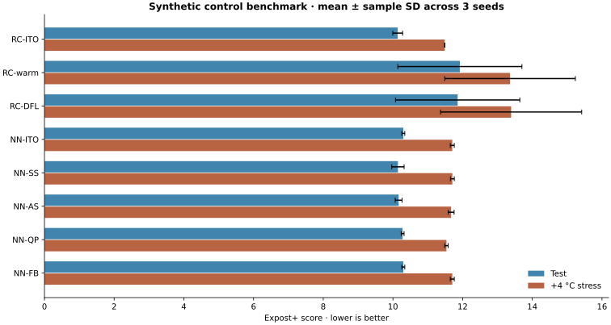

# Measured results

Start with the [five-zone EnergyPlus control pilot](energyplus/README.md) and
[offline comparison demo](energyplus/demo.html) for actual building control,
stronger prediction baselines and the RC initialization diagnosis. The studies
below provide the earlier identification, synthetic-control and bounds evidence.

Generated by `python scripts/build_report.py` from the committed raw CSVs.
These are independent project experiments, not numerical matches to the original paper tables.

## Public EnergyPlus-data identification

Two author-published **typical meteorological files** are used, with source periods
1991–2020 and 2006–2020. They are not independent calendar-year field observations.
The first file provides 7,059 training and 1,680 validation transitions; the second
provides 8,759 test transitions. Every fifth week is validation, with adjacent
training transitions embargoed. Normalization is fitted on training rows only.

An audit finds 67 exact input matches between the two files. The additional
diagnostic removes all of them without refitting, leaving 8,692 test transitions.
This does not prove statistical independence: both files concern the same building
and location, and their source weather periods overlap.

| Hidden neurons | Full-file RMSE, °C | Disjoint-input RMSE, °C |
| --- | --- | --- |
| 2 | 0.594 ± 0.005 | 0.582 ± 0.005 |
| 5 | 0.448 ± 0.025 | 0.435 ± 0.019 |
| 10 | 0.349 ± 0.007 | 0.345 ± 0.007 |

Values are mean ± **sample standard deviation across three initialization seeds**,
not confidence intervals. Persistence RMSE is 0.602 °C on the complete file and
0.566 °C on the disjoint-input diagnostic. The 10-neuron model improves
that diagnostic RMSE by **39.1%**. This measures one-step prediction,
not physical control performance or energy savings.

[Raw fits](public_data/identification.csv) · [Source/split manifest](public_data/manifest.json)

## Original extension: reachable-state intervals

54 paired instances × three formulations = 162 solves. Networks have 2 or 5
hidden neurons, five zones, three seeds, horizons of 6/12/24 hours and ambient
means of 5/20/32 °C. Every formulation has the same network, objective, initial
state, 10–35 °C declared domain and 3 kW zonal heating/cooling capacities.
The solver has five seconds per solve and target relative gap 1e-6.

| Bounds | Certified / total | Mean binaries | Mean wall time, s |
| --- | --- | --- | --- |
| reachable | 35/54 | 45.56 | 2.471 |
| static | 35/54 | 46.17 | 2.386 |
| weather | 35/54 | 45.56 | 2.402 |

Recursive bounds reduce total preactivation width by **14.2% on average
per instance**, relative to weather-only bounds. The additional binary reduction
is zero on every instance. Both modes certify 35/54 instances, with
**34 jointly certified pairs**. The largest objective difference in
those pairs is **4.3e-06**.

The remaining pairs are not evidence of optimal-objective equality: their
incumbents can differ substantially at timeout. All outcomes remain in the raw
table. The induction argument and independent small-instance enumeration support
the formulation's equivalence separately from these time-limited comparisons.

**No runtime improvement is demonstrated.** There is one timing per case; the
initial ablation ran alongside other experiments on a shared machine. Timing is
included for transparency and must not be used as a controlled speed benchmark.
Tighter interval bounds alone did not remove additional unstable neurons here.

[Raw solves](bounds/runs.csv) · [Paired comparisons](bounds/paired.csv) ·
[Manifest](bounds/manifest.json) · [Derivation and prior work](../docs/ORIGINAL_EXTENSION.md)

## Synthetic decision-focused control

One nonlinear synthetic zone, eight-hour horizon, three training days, two
validation days, four test days and four +4 °C stress days per seed. There are
three seeds and eight methods, for 192 evaluation rows. NN pretraining uses up
to 250 epochs; downstream learning uses eight epochs. RC historical pretraining
uses 150 epochs. This is a small methodological benchmark, not a claim of
convergence or a reproduction of the full paper budgets.

| Method | Test Expost+ | +4 °C Expost+ | Prediction RMSE, °C |
| --- | --- | --- | --- |
| RC-ITO | 10.137 ± 0.141 | 11.486 ± 0.007 | 0.100 |
| RC-warm | 11.920 ± 1.781 | 13.360 ± 1.874 | 0.754 |
| RC-DFL | 11.857 ± 1.784 | 13.392 ± 2.025 | 0.732 |
| NN-ITO | 10.297 ± 0.043 | 11.703 ± 0.057 | 0.094 |
| NN-SS | 10.143 ± 0.178 | 11.705 ± 0.056 | 0.095 |
| NN-AS | 10.163 ± 0.098 | 11.670 ± 0.085 | 0.101 |
| NN-QP | 10.278 ± 0.041 | 11.535 ± 0.050 | 0.132 |
| NN-FB | 10.297 ± 0.043 | 11.703 ± 0.057 | 0.094 |

Each score first averages the four days **within a seed**; the table then reports
mean ± sample SD across the three seeds. Prediction RMSE uses 1,000 separate
synthetic transitions and is averaged across seeds. It is measured on the
historical transition distribution, not the controller's visited trajectories.

Expost+ = realized electricity bill + weighted squared-temperature discomfort +
mean squared hourly cost-prediction error. This is a composite learning score,
**not a euro-denominated bill**. The component metrics are available in the raw
CSV. The mean and SD are descriptive; three initializations are not a significance
test, and there is no claim that one method universally dominates another.

`RC-warm` is the perturbed RC-ITO initialization used for RC-DFL. Reporting it
separately exposes degradation caused by initialization noise. NN methods retain
the original checkpoint if it beats all trained candidates on validation. SS and
AS both receive two scalar objective evaluations per update; AS uses a paired
positive/negative perturbation. Validation costs are accounted for separately.
QP/FB select checkpoints using supervised power loss, while SS/AS use Expost+,
following the distinction between their learning signals.

[Raw per-day outcomes](benchmark/metrics.csv) · [Training histories](benchmark/training.json) ·
[Experiment manifest](benchmark/manifest.json) · [Aggregated components](benchmark/summary.csv)

## Reproduction and limitations

Run the experiment commands in the [README](../README.md#reproduce-the-experiments).
Public-data networks, synthetic NN initializations, raw measurements and manifests
are versioned; selected DFL parameters are regenerated by rerunning training. The demo and
mathematical correctness tests run in CI; the long training experiments are not
rerun on every push. `artifacts.json` records hashes of the measured inputs.

The independent EnergyPlus pilot now validates its physical actuation. Original
control-table replication still requires matching the authors' protocol, full
training runs and, for Paper 1, missing experimental details. See the
[remaining gates](../docs/REPRODUCTION_PLAN.md). The learned-model bounds provide
no physical safety guarantee.
