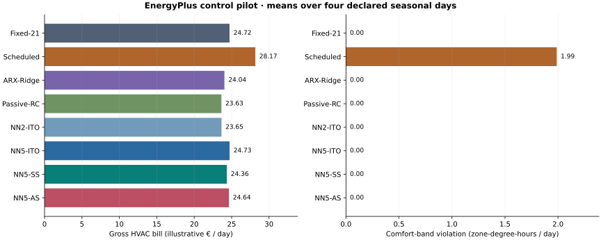
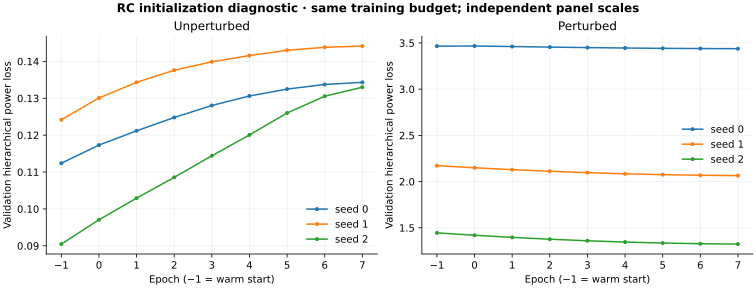

# From learned dynamics to an EnergyPlus building

**Executed pilot:** five controlled zones, 24-hour schedules, eight controllers,
four seasonal test days, EnergyPlus 22.1.0. The authors' pinned building and weather
are used; this does **not** reproduce either paper's complete numerical tables.

[Open the offline demo](demo.html) locally after cloning/downloading. Choose a day,
zone and two controllers to inspect recorded temperatures, electricity, gas,
weather and tariff. It displays saved simulations, not live optimization.



## Measured outcomes

Equal-weight **means over four declared days**, not annual savings or confidence
intervals. Controllers share the weather forecast, equipment, tariff and initial
state. Fixed and scheduled target trajectories are included as references.

| Controller | Electricity kWh | Gas kWh | HVAC € | Comfort zone-°C·h | Max solver gap |
| --- | --- | --- | --- | --- | --- |
| Fixed-21 | 57.98 | 0.53 | 24.72 | 0.00 | — |
| Scheduled | 67.30 | 0.28 | 28.17 | 1.99 | — |
| ARX-Ridge | 56.27 | 0.67 | 24.04 | 0.00 | 0.0% |
| Passive-RC | 55.56 | 0.31 | 23.63 | 0.00 | 0.0% |
| NN2-ITO | 55.73 | 0.19 | 23.65 | 0.00 | 0.0% |
| NN5-ITO | 58.28 | 0.38 | 24.73 | 0.00 | 261.7% |
| NN5-SS | 57.01 | 0.35 | 24.36 | 0.00 | 54.9% |
| NN5-AS | 58.11 | 0.38 | 24.64 | 0.00 | 54.6% |

In this run, NN5-SS has **5.3% lower mean electrical Expost+** than
NN5-ITO (29.879 versus
31.542). However, **Passive-RC has the
lowest mean HVAC bill**, at €23.63 per day.
The learned objective and operating cost rank the controllers differently;
the small pilot does not show DFL dominating simpler controllers.

`Fixed-21` requests 21 °C all day; `Scheduled` requests 21 °C during 08:00–18:00
and 18 °C otherwise. Both use the same ±0.05 °C heating/cooling deadband. The
latter can actively cool to 18 °C overnight: it is a fixed trajectory comparator,
**not** a conventional wide-deadband energy-saving setback strategy.

Gross HVAC consumption excludes PV and other building loads. Illustrative tariffs:
€0.25/0.45/0.65 per kWh electricity and €0.10 per kWh gas. Comfort-band violation
is integrated every 15 minutes across all zones: 20–24 °C during 08:00–18:00,
18–26 °C otherwise. Lower cost at worse comfort is a tradeoff, not a universal win.
[All daily metrics](metrics.csv), [hourly trajectories](hourly.csv) and
[quarter-hour temperatures](quarter_hour.csv) remain available.

**Optimization:** 4/16 neural test schedules reach the
requested 0.01% relative-gap tolerance within 10 seconds.
All other incumbents and gaps are retained. Fallbacks: 0.
Shared-machine timing does not support a speed comparison. The maximum native
SQL/API and hourly/subhourly reconciliation residual is 4.44e-16.
Native engine warning summaries remain in [audits.json](audits.json); successful completion
does not imply a warning-free building or deployment readiness.

## Learning and evaluation protocol

Pretraining uses the 1991–2020 public file with held-out weeks. Physical experiments
use the 2006–2020 EPW. Training: January 10 / July 11; validation: April 11 / October
10; test: January 17 / April 18 / July 18 / October 17, calendar 2017. Each run has
the same two days of 21 °C preconditioning. Future test days never select weights.

The seed-0 five-neuron model gets 4 SS/AS epochs and two loss
evaluations per update on each of two training days. Both estimators receive the
same evaluation budget. The warm start remains eligible; epoch −1 means it wins.

| Method | Selected epoch | Initial validation Expost+ | Best validation Expost+ | Train / validation evaluations |
| --- | --- | --- | --- | --- |
| NN5-SS | 1 | 23.388 | 22.882 | 16 / 10 |
| NN5-AS | 0 | 23.388 | 22.739 | 16 / 10 |

The learning objective is **electrical** Expost+ with hourly endpoint discomfort
and cost mismatch. Gas and subhourly comfort are independent diagnostics, so
improving the objective need not improve them. Selected NN weights, loss calls
and [protocol.json](protocol.json) are committed. This small one-seed pilot does
not establish convergence or a universal DFL advantage.

## Stronger prediction baselines

Identical public data, split masks, author time convention, train-only scaling
and 8,692 exact-input-disjoint test transitions:

| Model | Disjoint-input RMSE (°C) |
| --- | --- |
| ARX-Ridge | 0.464 |
| Passive-RC | 0.489 |
| NN10 · three-seed mean | 0.345 |
| Persistence | 0.566 |

Regularization is selected on validation only. Passive RC constrains thermal
exchange signs and Euler state weights; it is an extra comparator, not a change
to Paper 1's literal model. [Fits and selections](../prediction_baselines/).

## RC initialization diagnosis



The paired three-seed synthetic diagnostic repeats eight DFL epochs with and
without 1/25 relative Gaussian parameter perturbation, allowing validation
rollback. Without perturbation, **3/3 seeds retain epoch −1**. Perturbed
DFL achieves mean test Expost+ 11.857,
versus 10.137 for intact ITO. Partial recovery
from initialization damage is not a gain over ITO. [Curves, selected parameters
and all outcomes](../rc_initialization/). This diagnostic is synthetic, not an
explanation of every EnergyPlus outcome.

## Reproduce

```bash
python scripts/setup_energyplus.py --install-linux
python scripts/run_prediction_baselines.py
python scripts/run_energyplus_pilot.py --resume
python scripts/run_rc_initialization_ablation.py
python scripts/build_energyplus_report.py
```

For the committed pilot directory use `--resume`, or choose a fresh `--output`
directory to rerun it. Resume rejects a changed protocol. Time-limited incumbents
and checkpoint selection can vary with hardware. [Integration details and
remaining original-paper gates](../../docs/ENERGYPLUS_INTEGRATION.md).
